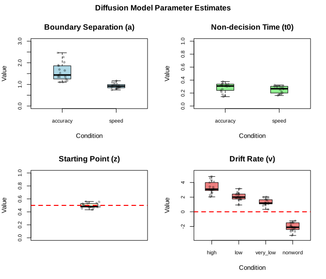
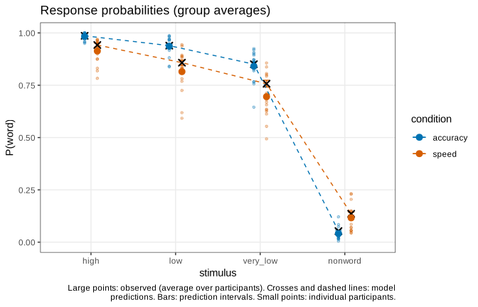
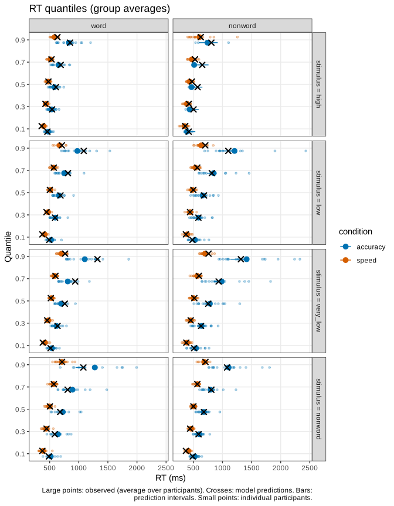
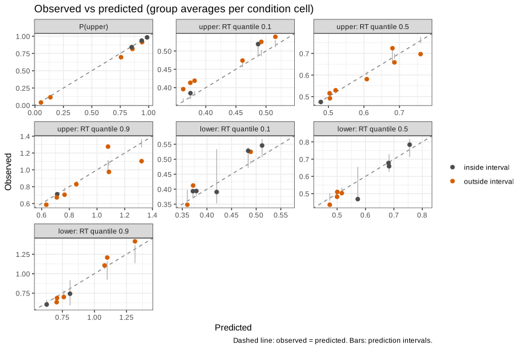
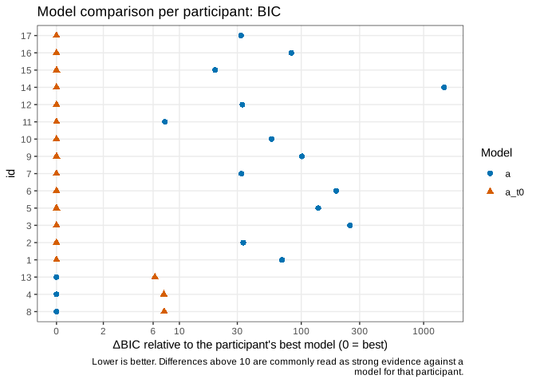
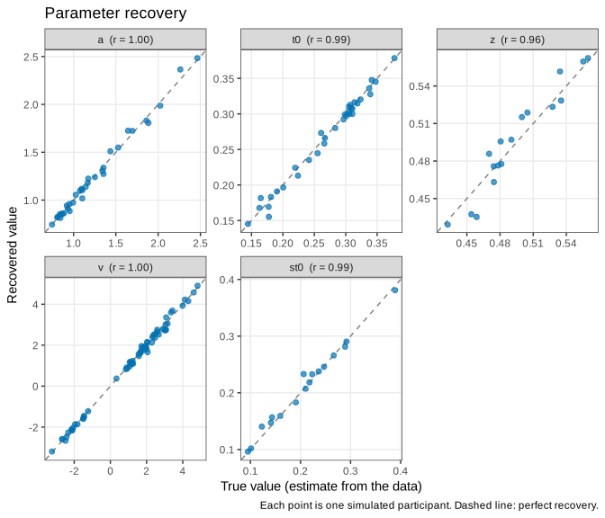
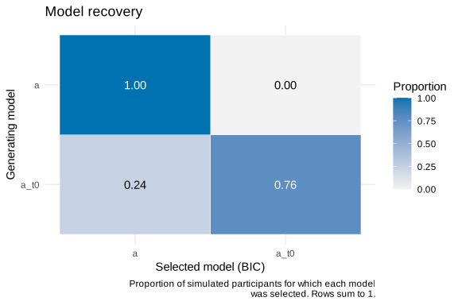

<!--
This vignette is precomputed because the analysis takes about an hour to run.
Edit driftd.Rmd.orig (not driftd.Rmd) and rebuild driftd.Rmd from the vignettes directory with

  knitr::knit("driftd.Rmd.orig", output = "driftd.Rmd")
-->


driftd fits the diffusion decision model to each participant by maximum likelihood. All
diffusion model computations are done by the
[rtdists](https://CRAN.R-project.org/package=rtdists) package (Singmann et al.); driftd builds
the likelihood from a model specification and provides tools for checking and analyzing the
fits.


```r
library(driftd)
```

# Data

`speed_acc`: 17 participants in a lexical decision task (word or nonword?) with speed or
accuracy instructions (Wagenmakers et al., 2008, Experiment 1, as distributed with rtdists).


```r
data(speed_acc)
head(speed_acc)
#>   id condition stimulus response    rt
#> 1  1     speed  nonword        0 0.700
#> 2  1     speed very_low        0 0.392
#> 3  1     speed  nonword        0 0.460
#> 4  1     speed very_low        1 0.455
#> 5  1     speed      low        0 0.505
#> 6  1     speed  nonword        0 0.773
with(speed_acc, round(tapply(response, list(stimulus, condition), mean), 2))  # P("word")
#>          accuracy speed
#> high         0.98  0.91
#> low          0.94  0.81
#> very_low     0.84  0.69
#> nonword      0.04  0.12
```

driftd needs one row per trial with a participant ID, the response (0/1 or "lower"/"upper"),
the RT in seconds, and the condition columns. Here, "word" responses (1) are the upper boundary.

# Fitting

Two models. In both, the instruction affects boundary separation (`a`), and the drift rate
(`v`) depends on the stimulus. The second model also lets the instruction affect the
non-decision time (`t0`). The across-trial variability of `t0` (`st0`) is estimated; `sz` and
`sv` are fixed at 0 (the default).


```r
fit_a <- driftd(speed_acc, sub_id = "id", response = "response", rt = "rt",
                vary_a = "condition", vary_v = "stimulus", fix_st0 = FALSE)
fit_at0 <- driftd(speed_acc, sub_id = "id", response = "response", rt = "rt",
                  vary_a = "condition", vary_t0 = "condition", vary_v = "stimulus",
                  fix_st0 = FALSE)
```

Convergence (0 = converged) and the parameters across participants:


```r
table(fit_at0$fit_info$converge)
#> 
#>  0 
#> 17
fit_at0$summary
#>               Parameter  Mean   SD Fixed
#> a_accuracy   a_accuracy  1.57 0.41 FALSE
#> a_speed         a_speed  0.93 0.11 FALSE
#> t0_accuracy t0_accuracy  0.28 0.07 FALSE
#> t0_speed       t0_speed  0.26 0.05 FALSE
#> z                     z  0.49 0.04 FALSE
#> v_high           v_high  3.31 0.80 FALSE
#> v_low             v_low  2.08 0.52 FALSE
#> v_very_low   v_very_low  1.30 0.45 FALSE
#> v_nonword     v_nonword -2.07 0.54 FALSE
#> st0                 st0  0.21 0.08 FALSE
#> sz                   sz  0.00 0.00  TRUE
#> sv                   sv  0.00 0.00  TRUE
```


```r
plot(fit_at0)
```

<div class="figure">

<p class="caption">plot of chunk parameters</p>
</div>

# Estimates

`estimates()` returns one row per participant and parameter, with standard errors:


```r
head(estimates(fit_at0))
#>   id parameter condition stimulus        name  estimate          se fixed converge
#> 1  1         a  accuracy     <NA>  a_accuracy 1.1031590 0.026696492 FALSE        0
#> 2  1         a     speed     <NA>     a_speed 1.0942016 0.024183474 FALSE        0
#> 3  1        t0  accuracy     <NA> t0_accuracy 0.3414487 0.003976795 FALSE        0
#> 4  1        t0     speed     <NA>    t0_speed 0.2966183 0.001901884 FALSE        0
#> 5  1         z      <NA>     <NA>           z 0.4811430 0.009704017 FALSE        0
#> 6  1         v      <NA>     high      v_high 3.9938495 0.183904596 FALSE        0
```

`format = "cells"` returns one row per participant and condition, for second-stage analyses:


```r
cells <- estimates(fit_at0, format = "cells")
head(cells)
#>   id condition stimulus n_trials        a        t0        z         v       st0 sz sv converge
#> 1  1  accuracy     high      160 1.103159 0.3414487 0.481143  3.993849 0.1011204  0  0        0
#> 2  1  accuracy      low      160 1.103159 0.3414487 0.481143  2.358738 0.1011204  0  0        0
#> 3  1  accuracy very_low      160 1.103159 0.3414487 0.481143  1.251598 0.1011204  0  0        0
#> 4  1  accuracy  nonword      480 1.103159 0.3414487 0.481143 -2.421565 0.1011204  0  0        0
#> 5  1     speed     high      160 1.094202 0.2966183 0.481143  3.993849 0.1011204  0  0        0
#> 6  1     speed      low      160 1.094202 0.2966183 0.481143  2.358738 0.1011204  0  0        0
```

For example, the effect of the instruction on boundary separation and non-decision time:


```r
by_condition <- unique(cells[, c("id", "condition", "a", "t0")])
with(by_condition, t.test(a[condition == "accuracy"], a[condition == "speed"], paired = TRUE))
#> 
#> 	Paired t-test
#> 
#> data:  a[condition == "accuracy"] and a[condition == "speed"]
#> t = 6.308, df = 16, p-value = 1.042e-05
#> alternative hypothesis: true mean difference is not equal to 0
#> 95 percent confidence interval:
#>  0.4237475 0.8527325
#> sample estimates:
#> mean difference 
#>         0.63824
with(by_condition, t.test(t0[condition == "accuracy"], t0[condition == "speed"], paired = TRUE))
#> 
#> 	Paired t-test
#> 
#> data:  t0[condition == "accuracy"] and t0[condition == "speed"]
#> t = 1.5896, df = 16, p-value = 0.1315
#> alternative hypothesis: true mean difference is not equal to 0
#> 95 percent confidence interval:
#>  -0.008991928  0.062897294
#> sample estimates:
#> mean difference 
#>      0.02695268
```

# Model fit

`predict()` computes observed and predicted response probabilities and RT quantiles, with
prediction intervals from simulated data:


```r
pred <- predict(fit_at0, seed = 1)
```


```r
plot(pred, type = "choice", response_labels = c(upper = "word", lower = "nonword"))
```

<div class="figure">

<p class="caption">plot of chunk fit-choice</p>
</div>


```r
plot(pred, response_labels = c(upper = "word", lower = "nonword"))
```

<div class="figure">

<p class="caption">plot of chunk fit-rt</p>
</div>


```r
plot(pred, type = "scatter")
```

<div class="figure">

<p class="caption">plot of chunk fit-scatter</p>
</div>

Participants with the most statistics outside their prediction intervals:


```r
head(summary(pred))
#>   id n_statistics n_outside prop_outside mean_abs_dev
#> 1  3           76        38    0.5000000   0.05510968
#> 2  6           96        37    0.3854167   0.05020901
#> 3  7           96        34    0.3541667   0.04214791
#> 4 10           91        32    0.3516484   0.03565580
#> 5  5           81        28    0.3456790   0.04369135
#> 6  8           91        30    0.3296703   0.07863603
```

# Model comparison


```r
cmp <- compare_models(a = fit_a, a_t0 = fit_at0)
cmp
#> Model comparison (17 participants; criteria summed over participants)
#> 
#>  model  k  logLik       AIC      BIC    dAIC   dBIC w_AIC w_BIC n_best_AIC n_best_BIC
#>      a  9 5916.38 -11526.76 -10684.8 2593.65 2500.1     0     0          3          3
#>   a_t0 10 7230.21 -14120.41 -13184.9    0.00    0.0     1     1         14         14
#>  n_not_converged
#>                0
#>                0
#> 
#> Lowest AIC: a_t0   Lowest BIC: a_t0
#> 
#> Likelihood-ratio tests of nested models:
#>  restricted full   chisq df      p n_significant n_negative boundary
#>           a a_t0 2627.65 17 <1e-04            14          0    FALSE
```


```r
plot(cmp)
```

<div class="figure">

<p class="caption">plot of chunk compare-plot</p>
</div>

# Parameter recovery

Simulates data from each participant's estimates, refits the model, and compares recovered
with true values:


```r
rec <- recover_parameters(fit_at0, seed = 1)
```


```r
rec
#> Parameter recovery (17 participants, 1 simulated dataset)
#> 
#> By parameter type (pooled over conditions):
#>  parameter  n    r  bias rmse
#>          a 34 1.00  0.00 0.04
#>         t0 34 0.99  0.00 0.01
#>          z 17 0.96  0.00 0.01
#>          v 68 1.00 -0.02 0.13
#>        st0 17 0.99  0.00 0.01
#> 
#> By parameter:
#>         name parameter  n    r  bias rmse
#>   a_accuracy         a 17 0.99  0.00 0.05
#>      a_speed         a 17 0.98  0.00 0.02
#>  t0_accuracy        t0 17 0.99  0.00 0.01
#>     t0_speed        t0 17 1.00  0.00 0.01
#>            z         z 17 0.96  0.00 0.01
#>       v_high         v 17 0.97 -0.01 0.19
#>        v_low         v 17 0.97 -0.04 0.13
#>   v_very_low         v 17 0.98  0.00 0.09
#>    v_nonword         v 17 0.99 -0.01 0.07
#>          st0       st0 17 0.99  0.00 0.01
```


```r
plot(rec)
```

<div class="figure">

<p class="caption">plot of chunk param-recovery-plot</p>
</div>

# Model recovery

Simulates data from each model, fits both models to each dataset, and records which model is
selected:


```r
mrec <- recover_models(a = fit_a, a_t0 = fit_at0, seed = 1)
```


```r
mrec
#> Model recovery (17 participants, 1 simulated dataset per model)
#> 
#> Selected by BIC, per simulated participant (rows: generating model):
#>           selected
#> generating    a a_t0
#>       a    1.00 0.00
#>       a_t0 0.24 0.76
#> 
#> Selected by AIC, per simulated participant (rows: generating model):
#>           selected
#> generating    a a_t0
#>       a    0.71 0.29
#>       a_t0 0.18 0.82
#> 
#> Selected by summed BIC, per simulated dataset:
#>           selected
#> generating a a_t0
#>       a    1    0
#>       a_t0 0    1
```


```r
plot(mrec)
```

<div class="figure">

<p class="caption">plot of chunk model-recovery-plot</p>
</div>

# Simulation

`simulate()` draws new data from the fitted model, with the observed number of trials:


```r
sims <- simulate(fit_at0, nsim = 2, seed = 1)
head(sims)
#>   sim id         .cell condition stimulus response        rt
#> 1   1  1 speed_nonword     speed  nonword    lower 0.4561145
#> 2   1  1 speed_nonword     speed  nonword    lower 0.5775215
#> 3   1  1 speed_nonword     speed  nonword    lower 0.3790121
#> 4   1  1 speed_nonword     speed  nonword    lower 0.4763153
#> 5   1  1 speed_nonword     speed  nonword    lower 0.4721630
#> 6   1  1 speed_nonword     speed  nonword    lower 0.4568311
```

# Citation

Please cite driftd and rtdists:


```r
citation("driftd")
#> Strueder, J. D. (2025). driftd: Easy diffusion model fitting and model checks via
#> 'rtdists'. R package version 0.0.0.9000. https://github.com/JStrueder/driftd
#> 
#> driftd computes all diffusion model densities with rtdists. Please also cite:
#> 
#>   Singmann, H., Brown, S., Gretton, M., & Heathcote, A. (2022). rtdists: Response time
#>   distributions. R package. https://CRAN.R-project.org/package=rtdists
#> 
#> To see these entries in BibTeX format, use 'print(<citation>, bibtex=TRUE)',
#> 'toBibtex(.)', or set 'options(citation.bibtex.max=999)'.
```

# References

Ratcliff, R., & McKoon, G. (2008). The diffusion decision model: Theory and data for two-choice
decision tasks. *Neural Computation, 20*, 873-922. https://doi.org/10.1162/neco.2008.12-06-420

Singmann, H., Brown, S., Gretton, M., & Heathcote, A. (2022). *rtdists: Response time
distributions*. R package. https://CRAN.R-project.org/package=rtdists

Wagenmakers, E.-J., Ratcliff, R., Gomez, P., & McKoon, G. (2008). A diffusion model account of
the criterion shifts in the lexical decision task. *Journal of Memory and Language, 58*,
140-159. https://doi.org/10.1016/j.jml.2007.04.006
