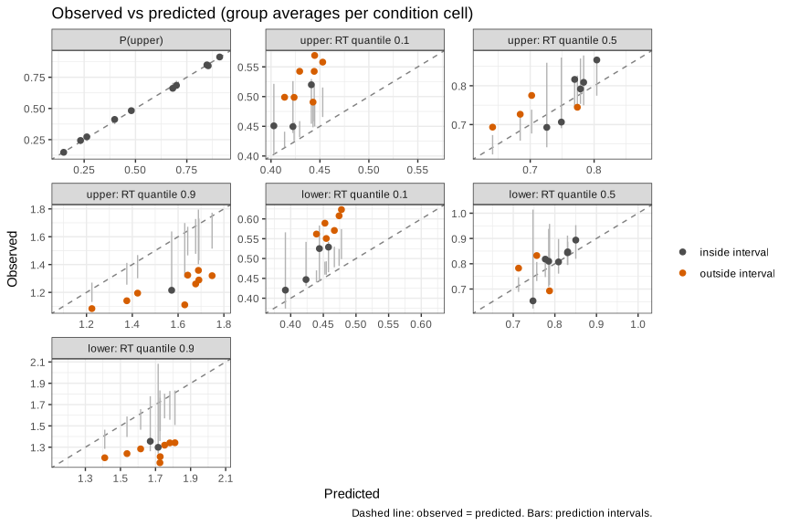

<!--
This vignette is precomputed because the analysis takes about 1-2 hours to run.
Edit driftd.Rmd.orig (not driftd.Rmd) and rebuild driftd.Rmd from the vignettes directory with

  knitr::knit("driftd.Rmd.orig", output = "driftd.Rmd")
-->


This vignette walks through a complete diffusion model analysis with **driftd**, from
the data to results that can be reported in a paper:

1. preparing the data,
2. specifying and fitting models,
3. checking how well a model describes the data,
4. comparing models that answer the research question,
5. checking that parameters and models can be recovered,
6. analyzing the parameter estimates, and
7. what to report.

driftd fits the diffusion model separately to each participant by maximum likelihood,
using the densities of the rtdists package. Results for the whole sample are then obtained
by analyzing the individual estimates with standard statistics (a *two-stage* approach). This
is a common, well-established approach for experiments with a moderate to large number of
trials per participant. It is not a hierarchical model: participants are not estimated jointly.


```r
library(driftd)
```

# 1. The data

The example data come from a study on *wishful predictions* (Strueder et al., 2025). The
analysis below demonstrates the workflow; it is not a substitute for the analyses reported in
that study.
On each trial, participants saw a grid of squares in two colors and predicted the color of a
randomly selected square. One color was the *critical* outcome, associated with a gain
(`val = "pos"`) or a loss (`val = "neg"`); the other color was neutral. The proportion of
squares in the critical color, `prob`, varied from .40 to .60, so `prob` is the objective
probability of the critical outcome.


```r
data(example_data)
head(example_data)
#>   ID     RT val prob R
#> 1  1 0.9252 pos 0.60 1
#> 2  1 1.4830 pos 0.50 1
#> 3  1 1.6719 pos 0.45 0
#> 4  1 1.1357 pos 0.40 0
#> 5  1 1.0128 pos 0.55 1
#> 6  1 1.3249 neg 0.40 0
```

driftd needs one row per trial with:

* a **participant identifier** (here `ID`),
* the **response**, coded `0`/`1` or `"lower"`/`"upper"` (here `R`: 1 = predicted the
  critical outcome, which becomes the upper boundary of the diffusion process),
* the **response time** in seconds (here `RT`; RTs in milliseconds are detected and
  converted), and
* the **condition columns** the parameters may depend on (here `val` and `prob`).

The response coding determines how the parameters are interpreted. Here the boundaries are
the two possible predictions, so a starting point `z` above .5 is a bias towards predicting
the critical outcome, and a positive drift rate `v` means evidence accumulates towards
predicting it.


```r
nrow(example_data)
#> [1] 11569
length(unique(example_data$ID))
#> [1] 30
table(example_data$val, example_data$prob)
#>      
#>        0.4 0.45  0.5 0.55  0.6
#>   neg 1159 1153 1157 1145 1165
#>   pos 1155 1155 1150 1164 1166
range(table(example_data$ID))   # trials per participant
#> [1] 326 397
```

The 30 participants contributed 326 to 397 trials each, about 35 per condition.

**Data screening is the researcher's responsibility.** Maximum likelihood estimation is
sensitive to contaminant responses (fast guesses, lapses of attention), so RTs should be
screened before fitting, and the criteria should be reported. driftd does not exclude trials or
participants. In these data, the fastest RT is 201 ms,
consistent with a lower cutoff of 200 ms having been applied:


```r
summary(example_data$RT)
#>    Min. 1st Qu.  Median    Mean 3rd Qu.    Max. 
#>  0.2012  0.5944  0.7591  0.8377  1.0141  2.4585
```

The proportions of critical-outcome predictions show the effect of interest: at every level of
`prob`, the critical outcome is predicted more often when it is a gain than when it is a loss.


```r
round(tapply(example_data$R, list(val = example_data$val, prob = example_data$prob), mean), 2)
#>      prob
#> val    0.4 0.45  0.5 0.55  0.6
#>   neg 0.14 0.27 0.48 0.69 0.85
#>   pos 0.24 0.41 0.66 0.85 0.92
```

The diffusion model can decompose this effect: valence could shift the **starting point**
(participants start closer to predicting a gain before evaluating the stimulus) and/or the
**drift rate** (the same stimulus is evaluated as more favorable to the gain).

# 2. Specifying models

A model is specified by which parameters vary across which condition columns
(`vary_a`, `vary_t0`, `vary_z`, `vary_v`, ...) and which are fixed (`fix_*` with values
`*_fixed`). By default, `a`, `t0`, `z` and `v` are estimated once per participant, and the
across-trial variabilities `st0`, `sz` and `sv` are fixed at 0. A parameter that varies is
estimated separately for every combination of levels of its condition columns.

The research question translates into four models. In all of them the drift rate depends on the
objective probability, `prob`:

| Model | Starting point `z` | Drift rate `v` | Valence affects |
|---|---|---|---|
| `none` | one value | by `prob` | nothing |
| `bias` | by `val` | by `prob` | starting point only |
| `drift` | one value | by `prob` x `val` | drift rate only |
| `drift_bias` | by `val` | by `prob` x `val` | both |

# 3. Fitting

We start with the most complete model. Fitting takes a few minutes for all participants;
driftd reports progress and a summary table while it runs.


```r
fit_drift_bias <- driftd(example_data, sub_id = "ID", response = "R", rt = "RT",
                         vary_z = "val", vary_v = c("prob", "val"))
```

Each participant has 14 free parameters: `a`, `t0`, two starting points and ten drift rates.
Starting values are derived from the data with EZ-diffusion (Wagenmakers et al., 2007). If an
optimization does not converge, or an estimate of `sv` or `sz` gets stuck at 0, driftd retries
from other starting values until the best solution has been found from two independent starting
points. Always check convergence before interpreting the estimates:


```r
fit_drift_bias$convergence                       # optimizer convergence codes (0 = converged)
#> 
#>  0 
#> 30
table(optimizer_runs = fit_drift_bias$fit_info$optimizer_runs)
#> optimizer_runs
#>  1 
#> 30
table(fit_drift_bias$fit_info$se_status)
#> 
#> ok 
#> 30
```

All 30 fits converged in the first optimizer run, and standard errors could be computed for all
participants. The mean and standard deviation of each parameter across participants:


```r
fit_drift_bias$summary
#>             Parameter  Mean   SD Fixed
#> a                   a  1.74 0.23 FALSE
#> t0                 t0  0.26 0.10 FALSE
#> z_neg           z_neg  0.51 0.06 FALSE
#> z_pos           z_pos  0.52 0.07 FALSE
#> v_0.4_neg   v_0.4_neg -1.23 0.62 FALSE
#> v_0.4_pos   v_0.4_pos -0.93 0.75 FALSE
#> v_0.45_neg v_0.45_neg -0.73 0.55 FALSE
#> v_0.45_pos v_0.45_pos -0.33 0.65 FALSE
#> v_0.5_neg   v_0.5_neg -0.07 0.52 FALSE
#> v_0.5_pos   v_0.5_pos  0.46 0.50 FALSE
#> v_0.55_neg v_0.55_neg  0.58 0.58 FALSE
#> v_0.55_pos v_0.55_pos  1.22 0.69 FALSE
#> v_0.6_neg   v_0.6_neg  1.20 0.68 FALSE
#> v_0.6_pos   v_0.6_pos  1.64 0.69 FALSE
#> st0               st0  0.00 0.00  TRUE
#> sz                 sz  0.00 0.00  TRUE
#> sv                 sv  0.00 0.00  TRUE
```

For further analyses, `estimates()` returns the estimates in long format, with the condition
values each parameter applies to and its standard error (from the numerical Hessian of the
log-likelihood):


```r
est <- estimates(fit_drift_bias)
head(est, 8)
#>   ID parameter  val prob       name    estimate          se fixed converge
#> 1  1         a <NA>   NA          a  1.48117512 0.040531143 FALSE        0
#> 2  1        t0 <NA>   NA         t0  0.16523048 0.007731234 FALSE        0
#> 3  1         z  neg   NA      z_neg  0.52715180 0.026384345 FALSE        0
#> 4  1         z  pos   NA      z_pos  0.52845781 0.027401169 FALSE        0
#> 5  1         v  neg 0.40  v_0.4_neg -0.39057165 0.219591056 FALSE        0
#> 6  1         v  pos 0.40  v_0.4_pos -0.23741771 0.245586852 FALSE        0
#> 7  1         v  neg 0.45 v_0.45_neg  0.01174765 0.257280218 FALSE        0
#> 8  1         v  pos 0.45 v_0.45_pos -0.03591552 0.231781174 FALSE        0
```

`estimates(fit, format = "cells")` returns one row per participant and condition with the value
of every parameter in that condition, which is the format needed for ANOVAs and mixed models
(section 6).

# 4. Checking model fit

Before interpreting parameters, check that the model describes the data. `predict()` computes,
for every participant and condition, the observed and predicted probability of each response
and the .1, .3, .5, .7 and .9 quantiles of its RT distribution. Predictions are exact. Prediction
intervals, obtained by simulating 200 datasets with the observed number of trials, show how much
the observed values are expected to vary if the model is correct.


```r
pred_drift_bias <- predict(fit_drift_bias, seed = 1)
```

Response probabilities are described well:


```r
plot(pred_drift_bias, type = "choice",
     response_labels = c(upper = "critical outcome", lower = "neutral outcome"))
```

<div class="figure">

<p class="caption">plot of chunk fit-choice</p>
</div>

The RT quantile plot shows each response in a column and each level of `prob` in a row. Large
points are observed quantiles averaged over participants, crosses are predictions, bars are
prediction intervals and small points are individual participants:


```r
plot(pred_drift_bias, response_labels = c(upper = "critical", lower = "neutral"))
```

<div class="figure">

<p class="caption">plot of chunk fit-rt</p>
</div>

The fit is good for the central quantiles, but there is systematic misfit in the tails: the model
predicts the fastest responses (.1 quantiles) too fast and the slowest responses (.9 quantiles)
too slow. The observed-versus-predicted plot summarizes this for all conditions; orange points
fall outside their prediction intervals:


```r
plot(pred_drift_bias, type = "scatter")
```

<div class="figure">

<p class="caption">plot of chunk fit-scatter</p>
</div>

Misfit of this kind often means that one of the across-trial variability parameters, fixed at 0
so far, is needed. We return to this in section 5.3. `summary()` lists participants by how many
of their statistics fall outside the prediction intervals. About 5% would be expected by chance;
the participants at the top of the list are worth inspecting individually, e.g. with
`plot(pred_drift_bias, participant = 6)`:


```r
head(summary(pred_drift_bias))
#>   ID n_statistics n_outside prop_outside mean_abs_dev
#> 1  6           90        26    0.2888889    0.2280488
#> 2 19           95        23    0.2421053    0.3299532
#> 3 14           95        22    0.2315789    0.3135138
#> 4  3          110        21    0.1909091    0.2610919
#> 5  5          110        20    0.1818182    0.1583871
#> 6  8          105        18    0.1714286    0.2072972
```

All numbers behind these plots are available for custom plots or reporting:


```r
head(aggregate(pred_drift_bias), 6)
#>   val prob response   statistic quantile n_participants  observed predicted     lower     upper
#> 1 pos  0.6    upper probability       NA             30 0.9125444 0.9101816 0.8931467 0.9248508
#> 2 pos  0.6    upper    quantile      0.1             30 0.4988473 0.4132505 0.4142517 0.4410480
#> 3 pos  0.6    upper    quantile      0.3             30 0.5938953 0.5193041 0.5130060 0.5534526
#> 4 pos  0.6    upper    quantile      0.5             30 0.6932967 0.6423337 0.6242020 0.6737596
#> 5 pos  0.6    upper    quantile      0.7             30 0.8163100 0.8248988 0.7863468 0.8586967
#> 6 pos  0.6    upper    quantile      0.9             30 1.0833563 1.2206029 1.1283823 1.2666197
```

# 5. Comparing models

## 5.1 Fitting the alternatives


```r
fit_none  <- driftd(example_data, sub_id = "ID", response = "R", rt = "RT",
                    vary_v = "prob")
fit_bias  <- driftd(example_data, sub_id = "ID", response = "R", rt = "RT",
                    vary_z = "val", vary_v = "prob")
fit_drift <- driftd(example_data, sub_id = "ID", response = "R", rt = "RT",
                    vary_v = c("prob", "val"))
```

## 5.2 Comparison

`compare_models()` sums the log-likelihoods, AIC and BIC over participants (each participant is
fitted separately), counts how many participants each model describes best, and runs
likelihood-ratio tests for every pair of nested models:


```r
cmp <- compare_models(none = fit_none, bias = fit_bias, drift = fit_drift,
                      drift_bias = fit_drift_bias)
cmp
#> Model comparison (30 participants; criteria summed over participants)
#> 
#>       model  k   logLik      AIC      BIC   dAIC   dBIC w_AIC w_BIC n_best_AIC n_best_BIC
#>        none  8 -8321.30 17122.60 18071.54 939.79 387.26     0     0          7         14
#>        bias  9 -8038.37 16616.73 17684.28 433.91   0.00     0     1         10          8
#>       drift 13 -7735.97 16251.93 17793.95  69.11 109.66     0     0          5          6
#>  drift_bias 14 -7671.41 16182.82 17843.45   0.00 159.17     1     0          8          2
#>  n_not_converged
#>                0
#>                0
#>                0
#>                0
#> 
#> Lowest AIC: drift_bias   Lowest BIC: bias
#> 
#> Likelihood-ratio tests of nested models:
#>  restricted       full   chisq  df      p n_significant n_negative boundary
#>        none       bias  565.87  30 <1e-04            18          0    FALSE
#>        none      drift 1170.67 150 <1e-04            19          0    FALSE
#>        none drift_bias 1299.79 180 <1e-04            19          0    FALSE
#>        bias drift_bias  733.91 150 <1e-04            13          0    FALSE
#>       drift drift_bias  129.11  30 <1e-04            10          0    FALSE
```


```r
plot(cmp)
```

<div class="figure">

<p class="caption">plot of chunk compare-plot</p>
</div>

The criteria disagree. AIC prefers `drift_bias`, and the likelihood-ratio tests show that adding
valence effects on the drift rate improves the fit beyond what is expected by chance (`drift`
versus `drift_bias`, and `bias` versus `drift_bias`). BIC, which penalizes additional parameters
more strongly, prefers `bias`. The plot shows each participant's BIC difference from their best
model: the individual results are heterogeneous, and for many participants BIC even prefers the
model without any valence effect.

Disagreement between AIC and BIC is common when effects are moderate and the number of trials
per condition is limited (here about 35). It is a reason to check how well the models can be
told apart with this design (section 6) and to report both criteria rather than only one.

## 5.3 Robustness: across-trial variability in drift

The model fit check showed misfit in the RT tails. Estimating the across-trial variability of the
drift rate, `sv`, is a standard way to address this, and its effect on the conclusions should be
checked:


```r
fit_drift_bias_sv <- driftd(example_data, sub_id = "ID", response = "R", rt = "RT",
                            vary_z = "val", vary_v = c("prob", "val"), fix_sv = FALSE)
```


```r
compare_models(drift_bias = fit_drift_bias, drift_bias_sv = fit_drift_bias_sv)
#> Model comparison (30 participants; criteria summed over participants)
#> 
#>          model  k   logLik      AIC      BIC  dAIC   dBIC w_AIC w_BIC n_best_AIC n_best_BIC
#>     drift_bias 14 -7671.41 16182.82 17843.45  0.00   0.00     1     1         26         28
#>  drift_bias_sv 15 -7655.24 16210.49 17989.74 27.67 146.29     0     0          4          2
#>  n_not_converged
#>                0
#>                0
#> 
#> Lowest AIC: drift_bias   Lowest BIC: drift_bias
#> 
#> Likelihood-ratio tests of nested models:
#>  restricted          full chisq df     p n_significant n_negative boundary
#>  drift_bias drift_bias_sv 32.33 30 0.352             3          0     TRUE
#> Note: boundary = TRUE means the restricted model fixes a variability parameter at 0; the test is then conservative.
```


```r
pred_drift_bias_sv <- predict(fit_drift_bias_sv, seed = 1)
```


```r
plot(pred_drift_bias_sv, type = "scatter")
```

<div class="figure">

<p class="caption">plot of chunk fit-scatter-sv</p>
</div>

Estimating `sv` improves the log-likelihood only slightly, not enough to justify the extra
parameter (higher AIC and BIC; the likelihood-ratio test is not significant, although it is
conservative because `sv = 0` lies on the boundary), and the misfit in the RT tails remains. The
leading edge of the RT distributions is slower than predicted, which points to variability in
non-decision time (`fix_st0 = FALSE`) as a next candidate. Here, we continue with the simpler
model and would report the remaining misfit.

# 6. Parameter and model recovery

A model comparison or parameter estimate is only informative if the design allows the
parameters and models to be recovered (Wilson & Collins, 2019).

**Parameter recovery** simulates data from each participant's estimates with the observed number
of trials, refits the model, and compares the recovered with the true values:


```r
rec <- recover_parameters(fit_drift_bias, seed = 1)
```


```r
rec
#> Parameter recovery (30 participants, 1 simulated dataset)
#> 
#> By parameter type (pooled over conditions):
#>  parameter   n    r bias rmse
#>          a  30 0.97 0.02 0.06
#>         t0  30 0.99 0.00 0.01
#>          z  60 0.94 0.00 0.02
#>          v 300 0.98 0.01 0.24
#> 
#> By parameter:
#>        name parameter  n    r  bias rmse
#>           a         a 30 0.97  0.02 0.06
#>          t0        t0 30 0.99  0.00 0.01
#>       z_neg         z 30 0.95  0.00 0.02
#>       z_pos         z 30 0.94  0.00 0.03
#>   v_0.4_neg         v 30 0.86 -0.02 0.33
#>   v_0.4_pos         v 30 0.97 -0.01 0.22
#>  v_0.45_neg         v 30 0.94  0.03 0.20
#>  v_0.45_pos         v 30 0.92 -0.07 0.27
#>   v_0.5_neg         v 30 0.95 -0.01 0.16
#>   v_0.5_pos         v 30 0.91  0.04 0.22
#>  v_0.55_neg         v 30 0.94 -0.02 0.23
#>  v_0.55_pos         v 30 0.94  0.02 0.24
#>   v_0.6_neg         v 30 0.95  0.08 0.22
#>   v_0.6_pos         v 30 0.94  0.08 0.25
```


```r
plot(rec)
```

<div class="figure">

<p class="caption">plot of chunk param-recovery-plot</p>
</div>

Recovery is good: recovered and true values correlate between .86 and .99, with negligible bias.
Trade-offs between parameters show up as correlated recovery errors:


```r
round(rec$error_correlation[1:4, 1:4], 2)
#>           a    t0 z_neg z_pos
#> a      1.00 -0.65  0.26 -0.34
#> t0    -0.65  1.00 -0.13  0.30
#> z_neg  0.26 -0.13  1.00 -0.01
#> z_pos -0.34  0.30 -0.01  1.00
```

The errors of `a` and `t0` are negatively correlated, a well-known trade-off: when the boundary
separation is overestimated, the non-decision time tends to be underestimated.

**Model recovery** simulates data from each of the competing models, fits all models to every
simulated dataset, and records which model is selected. This takes a while, because every model
is fitted to data from every model:


```r
mrec <- recover_models(bias = fit_bias, drift = fit_drift, drift_bias = fit_drift_bias, seed = 1)
```


```r
mrec
#> Model recovery (30 participants, 1 simulated dataset per model)
#> 
#> Selected by BIC, per simulated participant (rows: generating model):
#>             selected
#> generating   bias drift drift_bias
#>   bias        1.0  0.00       0.00
#>   drift       0.6  0.40       0.00
#>   drift_bias  0.7  0.17       0.13
#> 
#> Selected by AIC, per simulated participant (rows: generating model):
#>             selected
#> generating   bias drift drift_bias
#>   bias       0.87  0.03        0.1
#>   drift      0.13  0.77        0.1
#>   drift_bias 0.30  0.20        0.5
#> 
#> Selected by summed BIC, per simulated dataset:
#>             selected
#> generating   bias drift drift_bias
#>   bias          1     0          0
#>   drift         0     1          0
#>   drift_bias    0     0          1
```


```r
plot(mrec)
```

<div class="figure">

<p class="caption">plot of chunk model-recovery-plot</p>
</div>

The rows show the model that generated the data and the columns the model selected by BIC for
each simulated participant. Values close to 1 on the diagonal mean that the models can be told
apart with this design.

At the level of individual participants, BIC is strongly biased towards the simplest model: it
selected `bias` for most participants simulated from `drift` or `drift_bias`. Individual BIC
selections, as in the plot in section 5.2, should therefore not be read as evidence against
valence effects on the drift rate. AIC is much less biased. With the criteria summed over
participants, every generating model was recovered, although a single simulated dataset per
model is only a rough check (use `n_rep` for a more precise estimate). That the summed BIC
nevertheless prefers `bias` for the real data, where the model also shows misfit, illustrates why
conclusions should rest on several sources of evidence.

# 7. Analyzing the estimates

In the second stage, the individual estimates are analysed like any other dependent variable.
Participants whose fits did not converge should be inspected or excluded first.

**Starting point.** Does valence shift the starting point? A paired t-test on the two starting
points:


```r
z <- subset(estimates(fit_drift_bias), parameter == "z" & converge == 0)
z_wide <- reshape(z[, c("ID", "val", "estimate")], idvar = "ID", timevar = "val", direction = "wide")
colMeans(z_wide[, -1])
#> estimate.neg estimate.pos 
#>    0.5078105    0.5235068
t.test(z_wide$estimate.pos, z_wide$estimate.neg, paired = TRUE)
#> 
#> 	Paired t-test
#> 
#> data:  z_wide$estimate.pos and z_wide$estimate.neg
#> t = 1.0544, df = 29, p-value = 0.3004
#> alternative hypothesis: true mean difference is not equal to 0
#> 95 percent confidence interval:
#>  -0.01474920  0.04614181
#> sample estimates:
#> mean difference 
#>      0.01569631
```

**Drift rate.** How do probability and valence affect the drift rate? A repeated-measures ANOVA on
the `cells` format:


```r
cells <- subset(estimates(fit_drift_bias, format = "cells"), converge == 0)
cells$ID <- factor(cells$ID)
cells$prob <- factor(cells$prob)
round(tapply(cells$v, list(val = cells$val, prob = cells$prob), mean), 2)
#>      prob
#> val     0.4  0.45   0.5 0.55  0.6
#>   neg -1.23 -0.73 -0.07 0.58 1.20
#>   pos -0.93 -0.33  0.46 1.22 1.64
summary(aov(v ~ prob * val + Error(ID / (prob * val)), data = cells))
#> 
#> Error: ID
#>           Df Sum Sq Mean Sq F value Pr(>F)
#> Residuals 29  19.44  0.6702               
#> 
#> Error: ID:prob
#>            Df Sum Sq Mean Sq F value Pr(>F)    
#> prob        4 248.38   62.09   140.9 <2e-16 ***
#> Residuals 116  51.11    0.44                   
#> ---
#> Signif. codes:  0 '***' 0.001 '**' 0.01 '*' 0.05 '.' 0.1 ' ' 1
#> 
#> Error: ID:val
#>           Df Sum Sq Mean Sq F value  Pr(>F)   
#> val        1  16.16  16.159      13 0.00115 **
#> Residuals 29  36.04   1.243                   
#> ---
#> Signif. codes:  0 '***' 0.001 '**' 0.01 '*' 0.05 '.' 0.1 ' ' 1
#> 
#> Error: ID:prob:val
#>            Df Sum Sq Mean Sq F value  Pr(>F)   
#> prob:val    4  0.993 0.24818   3.656 0.00766 **
#> Residuals 116  7.875 0.06789                   
#> ---
#> Signif. codes:  0 '***' 0.001 '**' 0.01 '*' 0.05 '.' 0.1 ' ' 1
```

Within the `drift_bias` model, valence does not shift the starting point (the paired t-test is not
significant, and the mean difference is small), but it does affect the drift rate: drift rates
towards the critical outcome are higher when it is a gain, and the size of this effect depends on
the probability (interaction). Together with the model comparison, a report would state that AIC
and likelihood-ratio tests support a valence effect on the drift rate, that BIC prefers a
starting-point account, and how model recovery informs the choice between them.

The same data frame can be used with mixed models (e.g. `lme4::lmer(v ~ prob * val + (1 | ID))`),
and the standard errors in `estimates()` allow weighting by the precision of each estimate.

# 8. What to report

A diffusion model analysis with this approach typically reports:

* **Data preparation:** RT cutoffs and other exclusion criteria, with the number of trials and
  participants excluded; the response coding (here: the two predictions as boundaries).
* **Model specification:** which parameters varied across which conditions, which were fixed and
  at which values, and the scaling convention (driftd and rtdists use a diffusion constant
  s = 1).
* **Estimation:** maximum likelihood per participant with rtdists densities, optimization with
  `nlminb`, EZ-diffusion starting values with automatic restarts, and how many fits converged
  (`fit$fit_info`).
* **Model fit:** observed and predicted response probabilities and RT quantiles (e.g. the
  `"choice"` and `"rt"` plots), and how misfit was handled.
* **Model comparison:** summed AIC and BIC, the number of participants best described by each
  model, and likelihood-ratio tests for nested models.
* **Recovery:** parameter recovery (correlations of true and recovered values) and, if models
  are compared, model recovery for the design.
* **Parameter estimates:** means and SDs per condition (individual estimates in supplementary
  material), and the second-stage analyses with effect sizes.
* **Software:** the versions of R, driftd and rtdists (`sessionInfo()`).


```r
packageVersion("driftd")
#> [1] '0.0.0.9000'
packageVersion("rtdists")
#> [1] '0.11.5'
```

# References

Ratcliff, R., & McKoon, G. (2008). The diffusion decision model: Theory and data for two-choice
decision tasks. *Neural Computation, 20*, 873-922.

Strueder, J. D., Park, I., Mordkoff, J. T., Pleskac, T. J., & Windschitl, P. D. (2025). The
cognitive mechanisms behind wishful predictions: A diffusion model decomposition. PsyArXiv.
https://doi.org/10.31234/osf.io/bt7m5_v1

Voss, A., Nagler, M., & Lerche, V. (2013). Diffusion models in experimental psychology: A
practical introduction. *Experimental Psychology, 60*, 385-402.

Wagenmakers, E.-J., van der Maas, H. L. J., & Grasman, R. P. P. P. (2007). An EZ-diffusion model
for response time and accuracy. *Psychonomic Bulletin & Review, 14*, 3-22.

Wilson, R. C., & Collins, A. G. E. (2019). Ten simple rules for the computational modeling of
behavioral data. *eLife, 8*, e49547.
